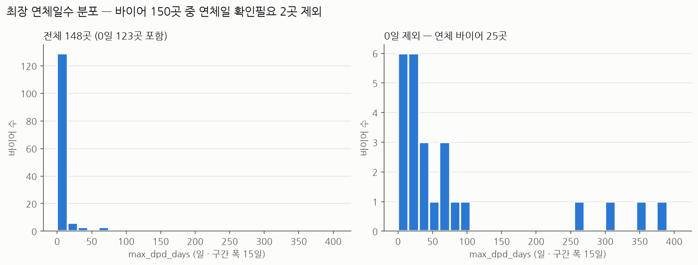
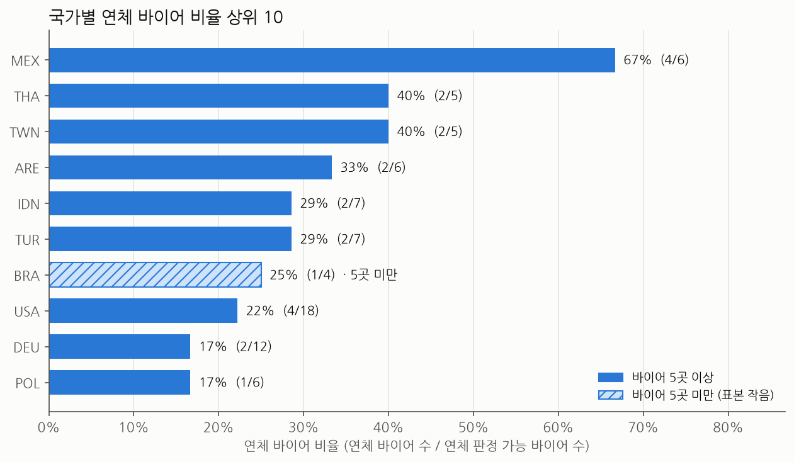
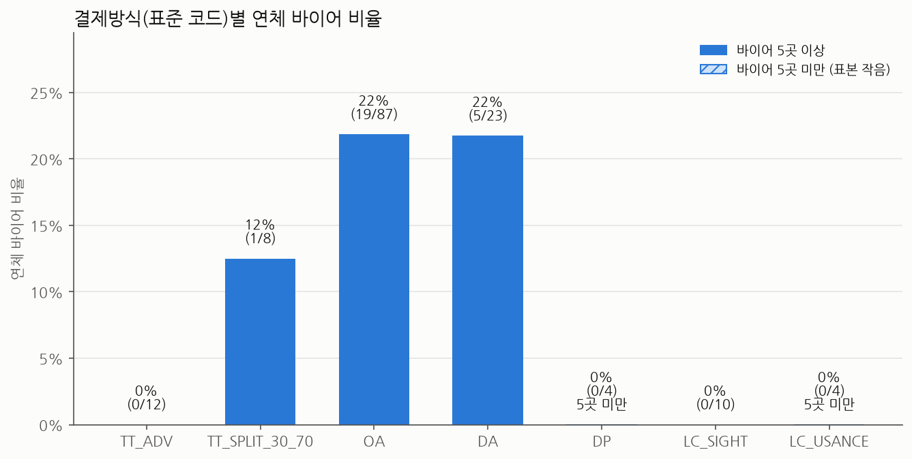

# 1일차 EDA 노트 — 바이어 연체 현황

- 원본: `data/day1/d1_buyers_raw.xlsx` (`buyers` 시트, 153행) + 코드표 `workbench/day1/outputs/d1_code_table.csv` — 원본은 읽기만 했다.
- 코드: 정리 규칙 `scripts/d1_clean_buyers.py` · 차트와 표 `workbench/day1/notebooks/d1_eda.ipynb`
- **연체 바이어 = `max_dpd_days > 0`**. 연체 바이어 비율 = 연체 바이어 수 ÷ 연체 판정 가능 바이어 수.

## 정리 규칙 (분석용 표는 메모리에서만 만든다)

| 규칙 | 내용 | 결과 |
|---|---|---|
| R1 중복 제거 | buyer_id 기준 첫 행만 남김 (근거: `d1_quality_report.md` 2절) | 153행 → 150행 |
| R2 결제방식 | `payment_terms_raw`를 코드표 '원래 표기'와 글자 그대로 맞춰 표준 코드 부여 | 미일치 0 · 7종 |
| R3 연체일 | `90일` · `381 days` → 숫자. `-` · `확인중`은 0으로 채우지 않고 '확인필요' | 확인필요 2곳: B058(`-`), B066(`확인중`) |
| R4 연체 여부 | `max_dpd_days > 0`, 확인필요는 판정 안 함(분모 제외) | 연체 25곳 / 판정 가능 148곳 = 16.9% |

## 결제방식별 연체 바이어

| 결제방식(표준 코드) | 바이어 수 | 연체 판정 가능 | 연체 바이어 수 | 연체 바이어 비율 | 연체일 확인필요 |
|---|---|---|---|---|---|
| TT_ADV | 12 | 12 | 0 | 0.0% | 0 |
| TT_SPLIT_30_70 | 8 | 8 | 1 | 12.5% | 0 |
| OA | 88 | 87 | 19 | 21.8% | 1 |
| DA | 24 | 23 | 5 | 21.7% | 1 |
| DP | 4 | 4 | 0 | 0.0% | 0 |
| LC_SIGHT | 10 | 10 | 0 | 0.0% | 0 |
| LC_USANCE | 4 | 4 | 0 | 0.0% | 0 |
| **합계** | 150 | 148 | 25 | 16.9% | 2 |

> 계산식: 연체 바이어 비율 = 연체 바이어 수 ÷ 연체 판정 가능 바이어 수. 연체 판정 가능 = 바이어 수 − 연체일 확인필요.
> 순서는 데이터 사전 codes 시트(payment_method)의 순서. DP · LC_USANCE는 바이어 5곳 미만이라 비율 비교에 주의.

## 차트 1. max_dpd_days 분포 (전체 · 0일 제외)

1. 연체 판정 가능 148곳 중 123곳(83.1%)이 0일이고, 연체 바이어는 25곳(16.9%)이다. 왼쪽 그림은 첫 막대(0~14일, 129곳)에 가려 연체 분포가 거의 보이지 않아서 0일 제외 그림을 함께 본다.
2. 연체 25곳의 중앙값은 31일이다. aging 구간별로 1-30일 12곳 · 31-60일 4곳 · 61-90일 5곳으로, 21곳이 90일 안에 몰려 있다.
3. 91일 이상 4곳(B071 TWN 269일 · B083 USA 305일 · B044 THA 355일 · B147 THA 381일)은 떨어진 꼬리이고 평균(81일)을 중앙값보다 크게 끌어올린다. 이 4곳은 `data/data_dictionary.xlsx` codes 시트 91+ 구간 note의 `DPD ≥ 91 (IFRS 9 90일 초과 = 채무불이행 반증 가능 추정)`에 해당하므로 바이어별로 확인할 대상이다.

## 차트 2. 국가별 연체 바이어 비율 상위 10

1. MEX가 67%(4/6)로 가장 높고, 2위 THA · TWN(각 40%, 2/5)과도 차이가 크다. 다만 국가별 바이어가 3~18곳뿐이라 1곳만 달라져도 비율이 6~33%p 움직인다. 순위보다 연체 바이어 수(분자)를 함께 읽는다.
2. 상위 10 가운데 바이어 5곳 미만 국가는 BRA(25%, 1/4) 하나이고, 연체 1곳으로 25%가 된 값이라 비교하기 어렵다. 연체 0곳인 국가도 7개국이다(JPN · GBR · NLD · SAU · EGY · MYS · NGA).
3. ARE(33%, 2/6)는 연체일 확인필요인 B066을 분모에서 뺀 값이다. B066은 연체금액이 있으므로 연체로 확인되면 3/7 = 43%가 되어 2위로 올라간다. THA 연체 2곳은 모두 91일 이상(B044 · B147, DA)이다.

## 차트 3. 결제방식(표준 코드)별 연체 바이어 비율

1. 연체 바이어 25곳 중 24곳이 OA(22%, 19/87)와 DA(22%, 5/23)에 몰려 있다. 데이터 사전 codes 시트 note를 보면 두 방식은 위험 부담이 수출자에게 있다(OA `위험: 수출자 전부` · DA `위험: 수출자(추심은행 지급보증 없음, URC 522)`).
2. TT_ADV(0/12)와 LC_SIGHT(0/10)는 연체가 0곳이고 TT_SPLIT_30_70은 12%(1/8)다. DP와 LC_USANCE도 0%이지만 각 4곳뿐(5곳 미만)이라 '연체가 없는 방식'이라는 근거로 쓰기는 어렵다.
3. 이 표는 결제방식과 연체가 함께 나타난다는 뜻일 뿐, 결제방식이 연체의 원인이라는 근거는 아니다(국가 · 업종과의 교차는 아직 보지 않았다). 민감도도 작다. 코드표 확신 '낮음' 중 연체는 B085(`10% T/T advance + 90% O/A 90 days` → OA) 1곳이라 코드가 바뀌어도 OA는 21%(18/86)가 된다. DA는 확인필요 B066이 연체로 확인되면 25%(6/24)가 된다.
